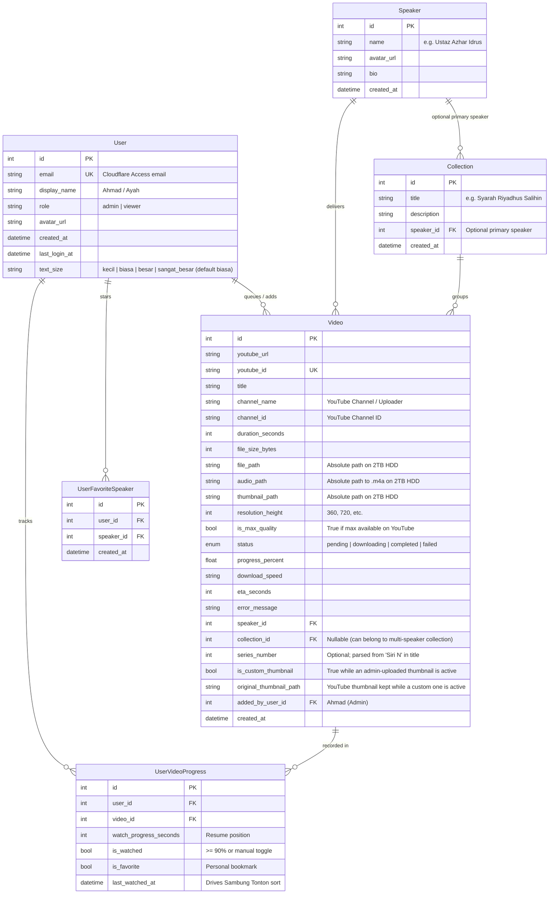
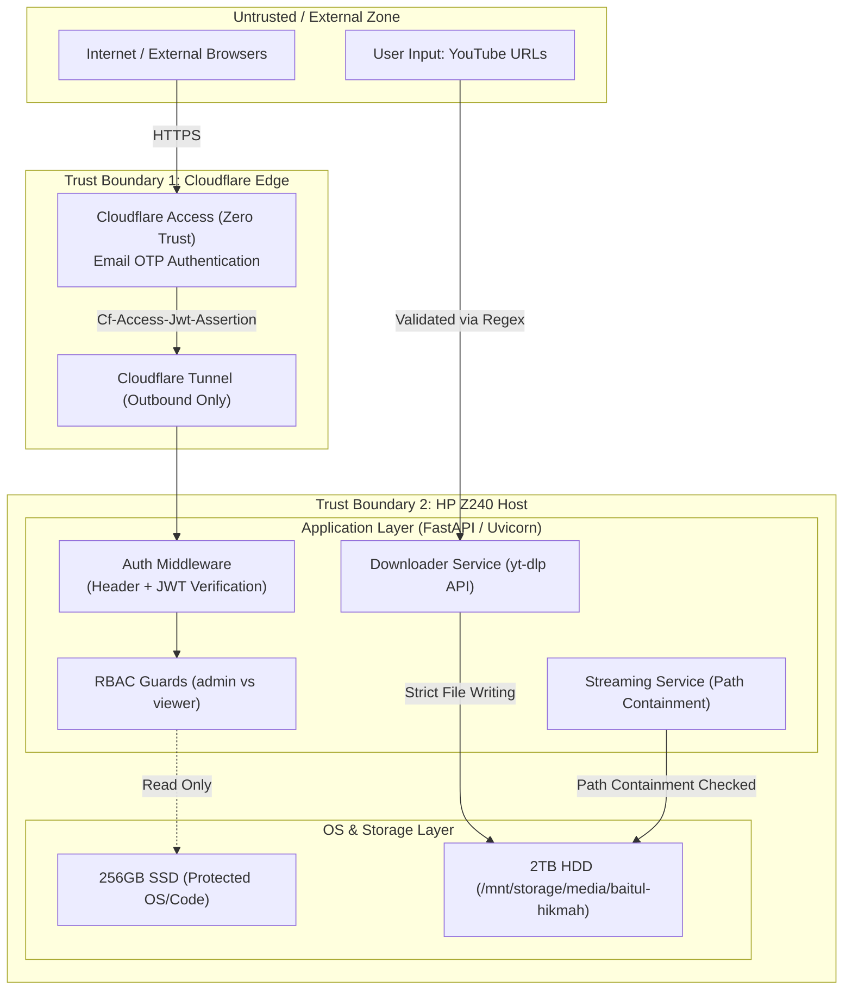

# Baitul Hikmah — Architecture & Requirements Specification
**Document Version:** 1.3  
**Status:** Requirements Refined & Finalized  
**Target Implementer:** Claude Code  

---

## 1. System Overview & Hardware Constraints

- **Host Machine:** HP Z240 Workstation (Ubuntu Server)
- **Primary OS Drive:** 256GB SSD (`/home/ahmadsalehuddin/code/personal/baitul-hikmah`)
  - **Rule:** Strictly for codebase, dependencies (`node_modules`, `venv`), and config. **NO media files or large DBs on SSD.**
- **Media & Storage Drive:** 2TB HDD mounted at `/mnt/storage`
  - Dedicated Baitul Hikmah directory: `/mnt/storage/media/baitul-hikmah`
  - Subdirectories:
    - `/mnt/storage/media/baitul-hikmah/videos/*.mp4`
    - `/mnt/storage/media/baitul-hikmah/thumbnails/*.webp`
    - `/mnt/storage/media/baitul-hikmah/baitul_hikmah.db`
  - Legacy directory (Read-only for migration): `/mnt/storage/media/ceramah`

---

## 2. Seed Users & Role-Based Access Control (RBAC)

### 2.1 Pre-seeded Accounts
| Email | Display Name | Role | Primary Use Case |
| :--- | :--- | :--- | :--- |
| `admin@example.com` | Ahmad | `admin` | Administer portal, download YouTube URLs, edit metadata, manage penceramah & collections, monitor server disk health. |
| `viewer@example.com` | Ayah | `viewer` | Senior-friendly viewing experience, personalized watch progress ("Sambung Tonton"), browse penceramah, toggle favorites. |

### 2.2 Permissions Matrix
| Action / Endpoint | Admin (Ahmad) | Viewer (Ayah) | Notes |
| :--- | :---: | :---: | :--- |
| **Browse Pustaka Ceramah** | Yes | Yes | Grid style view |
| **Play Video in Popup Modal (Video.js)** | Yes | Yes | Auto-start, resume progress |
| **Per-User Watch Progress ("Sambung Tonton")** | Yes (Personal) | Yes (Personal) | Unique per user account |
| **Favorite Video ("Kegemaran")** | Yes (Personal) | Yes (Personal) | Star/Heart toggle |
| **Favorite Penceramah** | Yes (Personal) | Yes (Personal) | 1-tap filter at top of library |
| **Tambah Ceramah (Download URL)** | **Yes** | **NO** | Restricted to Admin |
| **Sunting Butiran (Edit Video Info)** | **Yes** | **NO** | Restricted to Admin |
| **Urus Pustaka (Delete / Prune Videos)** | **Yes** | **NO** | Restricted to Admin |
| **View 2TB Server Storage Usage** | **Yes** | **NO** | Restricted to Admin |

---

## 3. Data Architecture (SQLModel / SQLite)



### 3.1 Key Schema Design Decisions
1. **Collections & Speakers Flexibility:** `Collection.speaker_id` is made **strictly optional (`Optional[int] = None`)**.
   - Single-speaker kitāb study (e.g. *Kitab Hikam* by Ustaz Nidzam) can link its primary speaker.
   - Multi-speaker thematic collections (e.g. *Daurah Ramadhan*, *Wacana Fiqh*, *Himpunan Kuliah Jumaat*) have `speaker_id = None`, with each individual `Video` referencing its respective `Speaker`.
2. **Decoupled Progress (`UserVideoProgress`):**
   - Playback progress, `is_watched`, and `is_favorite` are completely isolated per user account.
   - Composite Unique Index: `(user_id, video_id)`.
3. **Penceramah Favorites (`UserFavoriteSpeaker`):**
   - Allows Ayah to have a dedicated quick-access filter row of his favorite teachers at the top of the Pustaka without needing to search or type.

---

## 4. Video Player & UI Interaction Specification

### 4.1 Video Player Component (Video.js)
- **Engine:** `video.js` (React wrapper component).
- **Protocol:** HTTP 206 Partial Content (Byte-Range requests via `/api/stream/{video_id}`) for instant scrubbing on iOS, iPad, Safari, and desktop.
- **Features:**
  - Auto-start when modal opens (`autoplay: true`).
  - Resumes automatically from `watch_progress_seconds`.
  - Heartbeat: Throttled event sending progress updates every 5 seconds to `POST /api/progress/{video_id}`.
  - On `ended`: Sends `is_watched = true`.
  - Senior-friendly playback UI: Big pause/play button, 10s skip backward/forward buttons, large volume slider.

### 4.2 Pustaka Ceramah Popup Modal (Shadcn Dialog)
- In `PustakaPage.jsx`, clicking any video card / thumbnail triggers a Shadcn `Dialog`.
- **Modal Content Layout:**
  1. **Top Section:** 16:9 Video.js player container (auto-playing) with Mode Switcher (`[ 📹 Video ] [ 🎧 Audio ]`).
  2. **Metadata Header:**
     - Video Title in `font-heading` (`'Reem Kufi'`).
     - Speaker badge with avatar (links to speaker filter).
     - YouTube Channel badge (e.g. *Al-Khaadem*, *Madrasah Al Ikhlas*).
     - Duration badge and date added.
  3. **Action Bar:**
     - Mode Toggle: Video / Audio-Only.
     - "Tandai Telah Ditonton" (Toggle button).
     - "Kegemaran" (Star/Heart icon button).
  4. **Description Body:** Full lecture description and chapter notes (scrollable container with warm neutral styling).
  5. **Dismissal:** Closing the modal pauses playback and records final playback position.

### 4.3 Hybrid YouTube / Spotify Mode (Audio-Only Player)
*Designed specifically for senior convenience: listening in the car, on low data connections, or before sleeping with the phone screen turned off.*

1. **Backend Audio Extraction (1-Second Stream Copy):**
   - When a video is downloaded or migrated, extract the pure audio stream without transcoding:
     `ffmpeg -i input.mp4 -vn -c:a copy output.m4a`
   - Stored in `/mnt/storage/media/baitul-hikmah/audio/{video_id}.m4a`.
   - Adds only ~30MB–45MB per hour (tiny storage footprint on the 2TB drive).
2. **Frontend Spotify-Style Interface:**
   - When toggled to **Audio Mode**:
     - Video container shifts into an elegant "Now Playing" audio view with a warm Arabesque background pattern.
     - Center: High-resolution speaker portrait / kitāb artwork with subtle drop shadow.
     - Center/Bottom: Large, touch-friendly audio controls (10s back, extra-large Play/Pause, 10s forward, speed selector: 1x, 1.25x, 1.5x).
     - Seamless position sync: Switching between Video and Audio preserves the exact same playback timestamp (`currentTime`).
3. **Lock Screen & Background Audio (MediaSession API):**
   - Utilizes `navigator.mediaSession` metadata (`title`, `artist`: Speaker name, `album`: Collection name, `artwork`: Speaker avatar).
   - Allows Ayah to lock his phone/tablet and control playback directly from the lock screen or car Bluetooth controls without keeping the screen awake.

---

## 5. Legacy Migration from `ceramah-downloader`

### 5.1 Legacy Inspection Findings
- Legacy Project: `/home/ahmadsalehuddin/code/personal/ceramah-downloader`
- Legacy DB: `ceramah.db` containing **223 videos** in table `videos`:
  - `video_id` (YouTube 11-char ID)
  - `url` (Full YouTube link)
  - `title` (Structured title, e.g. `Risalah Cahaya Pengenalan | Ustaz Mohd Nidzam Bin Haji Omar | Madrasah Al Ikhlas | Siri 21`)
  - `duration` (integer seconds)
  - `file_path` (Filename in `/mnt/storage/media/ceramah/`)
- Existing video formats: `.mkv`, `.webm`, `.mp4`.

### 5.2 Migration Plan (`backend/scripts/migrate_legacy.py`)
1. **Safety First:** Read-only access to `/mnt/storage/media/ceramah` and `ceramah.db`.
2. **Metadata Extraction Heuristic:**
   - Parse pipe-delimited titles (`|` or `｜`):
     - Segment 1: Kitab / Collection Title (`Risalah Cahaya Pengenalan`)
     - Segment 2: Speaker Name (`Ustaz Mohd Nidzam Bin Haji Omar`)
     - Segment 3: Channel / Location (`Madrasah Al Ikhlas`)
     - Segment 4: Episode / Part (`Siri 21`)
   - Auto-create or link `Speaker` and `Collection`.
3. **Container Compatibility (FFmpeg Fast Remux):**
   - For `.mkv` and `.webm` files, execute `ffmpeg -i input.mkv -c copy output.mp4` to convert containers to `.mp4` without re-encoding (instant, zero quality loss, 100% compatible with iOS Safari byte-range streaming).
4. **Thumbnail Generation:** Extract frame at 00:01:00 as `.webp` thumbnail if missing.
5. **Database Linking:**
   - Insert into `Video` with status `completed`.
   - Set `added_by_user_id` to Ahmad's ID.
   - Set destination file path to `/mnt/storage/media/baitul-hikmah/videos/<filename>.mp4`.

---

## 6. Authentication: Cloudflare Zero Trust & Local Dev Strategy

### 6.1 Production Flow
- Cloudflare Access handles authentication in front of the home server tunnel.
- Cloudflare injects the HTTP request header:
  `Cf-Access-Authenticated-User-Email: viewer@example.com`
- Backend middleware matches email to database:
  - If `viewer@example.com` -> Authenticated as **Ayah (Viewer)**.
  - If `admin@example.com` -> Authenticated as **Ahmad (Admin)**.

**Implementation (2026-09-29, `backend/app/core/auth.py`):**
- `ENVIRONMENT=production` (set in `docker-compose.yml`): identity comes only from Cloudflare Access; `X-Dev-User-Email` is ignored and there is no admin fallback, so a request without an identity gets **401** (including `GET /videos`). `/api/health` stays open for the container health check; `/storage/*` thumbnails are static and not authenticated at the origin (Cloudflare Access still protects them at the edge).
- If `CF_ACCESS_TEAM_DOMAIN` (`<team>.cloudflareaccess.com`) and `CF_ACCESS_AUD` (the Access application's AUD tag) are set, every request must carry a valid `Cf-Access-Jwt-Assertion` (RS256, keys from `https://<team>.cloudflareaccess.com/cdn-cgi/access/certs`, issuer + audience + expiry checked). The user is the verified token's `email`; a differing `Cf-Access-Authenticated-User-Email` is rejected. Without those two variables the check is skipped and the email header is trusted as before (a warning is logged at start-up) — in that mode anyone who can reach `127.0.0.1:3000`/`:8000` on the server can forge the header, which is what the JWT check closes.
- `CF_ACCESS_EXTRA_ISSUERS` (comma-separated, defaulted in `docker-compose.yml` to the old team URL) lists additional accepted `iss` values: after a Zero Trust team rename, Cloudflare kept issuing tokens with the old team's issuer. Keys still come from `CF_ACCESS_TEAM_DOMAIN`, and signature + AUD are still enforced. In header-only mode the backend logs a token's public `iss`/`aud` once, to help fill these settings in.
- nginx strips any client `X-Dev-User-Email`, and the production frontend build no longer sends it.

### 6.2 Local Development Flow
- FastAPI supports the `X-Dev-User-Email` header fallback (and defaults to the admin account when no header is sent) **only when `ENVIRONMENT` is not `production`** (the default when running `python main.py`).
- In dev mode, a discrete user avatar switcher in the frontend navigation bar lets you toggle between Ahmad and Ayah to immediately test both views.

---

## 7. Security Architecture & Threat Model

### 7.1 Threat Model & Trust Boundaries



### 7.2 Entry Points & Untrusted Inputs
| Entry Point | Type | Trusted? | Threat Vectors | Mandatory Security Guard |
| :--- | :--- | :--- | :--- | :--- |
| `POST /api/videos/batch` | HTTP JSON | No | SSRF, Command Injection, Malicious URLs | 1. Strictly admin-only (`require_admin`).<br/>2. Strict regex whitelist for `youtube.com` and `youtu.be` links.<br/>3. Execute via Python `yt_dlp.YoutubeDL` API (never shell/subprocess). |
| `GET /api/stream/{video_id}` | HTTP GET | Semi | Path Traversal (`../../etc/shadow`) | 1. Video ID mapped from DB.<br/>2. `path.resolve().is_relative_to(STORAGE_DIR)` check before opening file. |
| `POST /api/progress/{video_id}` | HTTP POST | Semi | IDOR (Modifying another user's progress) | 1. Disregard user ID from body; strictly use `request.state.user.id` from verified session. |
| `Cf-Access-*` Headers | HTTP Header | Untrusted if direct | Header Spoofing / Privilege Escalation | 1. Bind Uvicorn strictly to `127.0.0.1` (never open public router ports).<br/>2. Verify `Cf-Access-Jwt-Assertion` cryptographic signature in production.<br/>3. Disable `X-Dev-User-Email` bypass when `ENVIRONMENT=production`. |

### 7.3 Specific Security Hardening Rules for Claude Code

#### 1. Zero Shell Execution for `yt-dlp`
* **Rule:** Never use `os.system()` or `subprocess.run(f"yt-dlp {url}", shell=True)`.
* **Implementation:** Always instantiate `with yt_dlp.YoutubeDL(ydl_opts) as ydl: ydl.download([validated_url])`.

#### 2. Strict YouTube URL Whitelist & SSRF Guard
* **Regex Pattern:** `r"^(https?://)?(www\.|m\.)?(youtube\.com/(watch\?v=|shorts/|playlist\?list=)|youtu\.be/)[a-zA-Z0-9_\-]{11}"`
* Any URL failing this pattern or resolving to `localhost`, internal subnets (`192.168.*`, `10.*`, `127.*`, `169.254.*`), or metadata services must be rejected immediately with HTTP 400.

#### 3. Path Traversal Containment (Streaming & Thumbnails)
```python
def verify_safe_path(target_path: Path, allowed_root: Path) -> Path:
    resolved_target = target_path.resolve()
    resolved_root = allowed_root.resolve()
    if not resolved_target.is_relative_to(resolved_root):
        raise HTTPException(status_code=403, detail="Akses ditolak: Laluan fail tidak sah.")
    if not resolved_target.exists():
        raise HTTPException(status_code=404, detail="Fail tidak dijumpai.")
    return resolved_target
```

#### 4. Disk Exhaustion & DoS Prevention
* **Quality Cap:** `format: "bestvideo[height<=720]+bestaudio/best[height<=720]"` — Prevents downloading 20GB 4K videos that waste disk space and home network bandwidth.
* **Low Disk Safeguard:** Check `shutil.disk_usage(STORAGE_DIR)`. If free space on `/mnt/storage` is less than 20GB, reject new downloads with HTTP 507 Insufficient Storage.
* **Sequential Download Queue:** Enforce maximum of 1 active download job at a time using an async queue (`asyncio.Queue`) so server memory and CPU are not overwhelmed.

#### 5. Strict Backend RBAC
* Frontend button hiding is **never** considered security.
* All state-mutating endpoints (`POST`, `PUT`, `DELETE` on videos, collections, speakers) MUST enforce a FastAPI dependency `require_admin` checking `user.role == Role.admin`.


---

## 8. Frontend Design System (Obra shadcn/ui)

### 8.1 Standing Design Rules (Permanent — applies to ALL agents and ALL future frontend work)
*Set by the System Owner on 2026-09-28. These rules override any conflicting guidance elsewhere.*

1. **shadcn/ui components only.** Every UI element must be built from official shadcn/ui components (the same components mirrored in the **Obra shadcn/ui Figma kit** used for the mockups in `docs/design/figma-ui/`). Components are added via the shadcn CLI into `frontend/src/components/ui/`. Never hand-roll an equivalent (e.g. custom dropdowns, raw `<select>`, homemade modals).
2. **Do not edit generated component source.** Files in `components/ui/` stay as the shadcn CLI generates them. App-specific pieces (e.g. lecture card, speaker card) are built by *composing* these components in feature files. **Sole exception:** a new *variant* may be added to a generated component's `cva` variants only if it uses theme tokens exclusively (no arbitrary values), has System Owner approval, and is logged in §8.2. Existing variants and base classes are never modified.
3. **Visual styling comes from the theme only.** Colours, typography, radius and shadows are defined exclusively by the theme tokens (CSS variables in `frontend/src/index.css`). `className` overrides on components are limited to layout (spacing, sizing, grid/flex, positioning) — never colour, font, radius or shadow.
4. **No arbitrary values.** No `text-[11px]`, inline hex colours, custom shadows, or other one-off styling. Use semantic token utilities (`bg-primary`, `text-muted-foreground`, …), never raw palette values.
5. **Theme changes require the System Owner's explicit permission.** Adding, removing or changing any theme token (colour, font, radius, shadow, spacing scale) must be approved by the System Owner first, then recorded in §8.2 below.
6. **Missing component = ask first.** If a design need cannot be met by an existing shadcn/ui component, stop and ask the System Owner rather than inventing a custom component or style.

### 8.2 Locked Theme & Approved Changes Log
**Locked baseline** (from `CLAUDE.md` → Design System & Figma Tokens and `docs/design/figma-variables/`):
- Fonts: `Reem Kufi` (headings), `Lato` (body), `Geist Mono` (mono).
- Colours: background `#FAFAF9`, foreground `#022C22`, primary `#96742B`, secondary `#E6F4EA`, secondary-foreground `#14532D`, muted/border `#E5E5E5`, card `#FFFFFF`.
- Base radius: `8px` (`0.5rem`).
- Focus ring: `#96742B` (gold). *Deliberately differs from the Figma kit's `#D4D4D4` — System Owner decision 2026-09-29.*
- Remaining shadcn tokens (accent, muted, muted-foreground, destructive, card/popover foregrounds, input, sidebar) take their exact hex values from `docs/design/figma-variables/shadcn-color.json`.

**Approved changes:**
| Date | Change | Approved by |
| :--- | :--- | :--- |
| 2026-09-28 | Add `--warning` / `--warning-foreground` tokens (for the invalid-link Alert on Tambah Ceramah) | System Owner |
| 2026-09-29 | `--warning` = `#FFFBEB` (amber-50, surface), `--warning-foreground` = `#92400E` (amber-800, text/icon) — sampled from the "Pautan Masalah" mockup | System Owner |
| 2026-09-29 | Keep focus ring `--ring` = `#96742B` (gold) instead of Figma's `#D4D4D4` | System Owner |
| 2026-09-29 | Add `warning` variant to `components/ui/alert.jsx` (§8.1.2 exception): `bg-warning text-warning-foreground border-warning-foreground/30`, icon and description in `text-warning-foreground`. Border uses foreground at 30% opacity — no separate border token. Used for invalid-link Alert (Tambah Ceramah) and low-disk Alert (Urus Pustaka). | System Owner |

---

### 8.3 Redesign Requirements (Phase 7)
*Drafted by Claude and reviewed with the System Owner on 2026-09-28. Gemini review optional (for future tracking). Mockups: `docs/design/figma-ui/`. All items below are bound by §8.1.*

#### 8.3.1 Platform & Foundation
- **Tailwind CSS v3 → v4** and the **current shadcn/ui CLI** (`components.json`, JSX — `tsx: false`). Required for Input Group, Button Group, Empty, Field and Spinner used in the mockups.
- **React 18 → 19** (approved by System Owner 2026-09-29): current shadcn/ui components no longer use `forwardRef`, so on React 18 refs are dropped and `asChild` triggers / Popover / Tooltip positioning break. Video.js is compatible.
- Legacy `brand.*` palette (`bg-brand-gold` etc.) and hard-coded `body` background are non-token styling (§8.1.3–4). They may be kept temporarily in 7.1 so current pages keep rendering, and must be fully removed by the end of 7.3.
- Tailwind v4 renamed utilities used by the current pages (`shadow-sm`→`shadow-xs`, `focus:outline-none`→`focus:outline-hidden`, `flex-shrink-0`→`shrink-0`, `backdrop-blur-sm`→`backdrop-blur-xs`, bare `rounded`→`rounded-sm`); migrate them with the upgrade (`npx @tailwindcss/upgrade`, repo is now under git). Add **Geist Mono** to the Google Fonts import (currently missing).
- Theme tokens from §8.2 ported into Tailwind v4 CSS variables unchanged (exact hex values preserved). Light mode only this phase; token structure must allow dark mode to be added later (`docs/design/figma-variables/shadcn-color-dark.json`).
- **React Router** replaces the tab state in `App.jsx`:

| Route | Page |
| :--- | :--- |
| `/` | Pustaka Ceramah (home) |
| `/penceramah/:id` | Speaker view (breadcrumb: Laman Utama › {Penceramah}) |
| `/koleksi/:id` | Collection view (breadcrumb: Laman Utama › {Penceramah} › {Koleksi Kitab}) |
| `/cari?q=` | Search results (breadcrumb: Laman Utama › Mencari "{q}") |
| `/tambah` | Tambah Ceramah (admin) |
| `/urus` | Urus Pustaka (admin) |
| `?tonton=<id>` | Opens the video player dialog on top of any page. Refresh/share reopens it; browser Back closes it. |

#### 8.3.2 Component Mapping (mockup → shadcn/ui)
| Mockup element | shadcn/ui component |
| :--- | :--- |
| Search bar (icon + ✕ clear), title field with `19/200` counter | Input Group |
| Tapis \| Susun joined buttons | Button Group + Dropdown Menu |
| Tapis options | Dropdown Menu Checkbox Items |
| Susun options | Dropdown Menu Label + Radio Group / Radio Items |
| Laman Utama › … | Breadcrumb |
| "Hasil Carian Tidak Dijumpai", "Tiada Ceramah Untuk Ditambah" | Empty |
| "Memuatkan ceramah" | Spinner |
| Profile (CN) menu | Avatar + Dropdown Menu |
| Top navigation incl. "Urus Pustaka ⌄" | Navigation Menu (desktop), Sheet (phone) |
| Upload cards | Card + Progress + Button (`secondary`) |
| Invalid-link warning | Alert `variant="warning"` (approved variant, §8.2) |
| Sunting Butiran Ceramah | Dialog + Field + Input Group |
| Koleksi Kitab / Penceramah pickers with "+ Tambah '…'" | Combobox (Popover + Command) |
| Duration on thumbnail | Badge |
| Watch progress on thumbnail | Progress |
| Delete confirmations | Alert Dialog |
| Admin tables | Table |

#### 8.3.3 Global Layout & Navigation
- Header: logo + "Baitul Hikmah" (`font-heading`), nav links **Pustaka Ceramah**, **Tambah Ceramah**, **Urus Pustaka ⌄**, avatar menu. Tambah/Urus hidden for `viewer` (backend `require_admin` remains the real guard).
- Profile menu: "Assalamualaikum, **{display_name}**" (spelling corrected from mockup), **Saiz Teks** control (§8.3.9), **Log Keluar**. Dev user switcher appears here **only in local development**.
- Page header pattern: H1 (`font-heading`) + one-line description + primary input, in a narrow centred column; content grid below in a wider column (as in mockups).

#### 8.3.4 Pustaka Ceramah (`/`, `/penceramah/:id`, `/koleksi/:id`, `/cari`)
- **Mixed grid** of three card types, all composed from shadcn parts:
  - **Video card:** 16:9 thumbnail, duration Badge bottom-right, gold Progress bar along the bottom when partially watched; title (**clamped to 2 lines** with ellipsis; full title via Tooltip on desktop, and in the player dialog); Koleksi Kitab name; Penceramah • relative date ("2 hari lalu").
  - **Koleksi Kitab card:** stacked-thumbnail look; title; speaker name(s) ("Ustaz A, Ustaz B dan lain"). Opens `/koleksi/:id`.
  - **Penceramah card:** Avatar centred on muted thumbnail area; name; "{n} ceramah dan {m} koleksi kitab". Opens `/penceramah/:id`.
- **Tapis:** Video Ceramah / Koleksi Kitab / Penceramah — **all ticked by default**; at least one must remain ticked (last one cannot be unticked). No "Semua" row. When not all are ticked, the Tapis button shows a count Badge (e.g. "Tapis · 2"). A separate group adds a **Kegemaran Sahaja** checkbox (favourites only).
- **Susun:** a **single** selection across groups:
  - *Mengikut Tarikh Muat Naik:* Sekarang – Dulu (**default**), Dulu – Sekarang
  - *Mengikut Abjad:* A – Z, Z – A
  - *Mengikut Siri* (Siri 1 → N): shown **only inside `/koleksi/:id`**, where it is the default. Uses the new `Video.series_number` field (§8.3.11).
- **Search:** Input Group with clear (✕); navigates to `/cari?q=`. No results → Empty ("Hasil Carian Tidak Dijumpai", "Padam carian dan cuba semula kata kunci yang baharu atau kembali ke halaman utama.", link "Laman Utama").
- **Progressive loading:** client-side batches (e.g. 24 cards) revealed on scroll with Spinner + "Memuatkan ceramah". No backend paging this phase.
- **Sambung Tonton:** single horizontal row of in-progress video cards above the grid, shown on `/` only when not searching/filtered to a speaker or collection. (Live feature, redesigned; not in mockups.)

#### 8.3.5 Video Player Dialog (no mockup — designed from shadcn parts)
- Dialog (wide on desktop; **full-screen on phone**), opened via `?tonton=<id>`.
- Top: 16:9 player area. Mode switch **Video / Audio** (Toggle Group).
- Metadata: title (`font-heading`); Penceramah Badge (links to `/penceramah/:id`), channel Badge, duration Badge, date added.
- Actions: **Tandai Telah Ditonton** and **Kegemaran** (Toggle / Button with pressed state).
- Description in Scroll Area.
- **Audio mode** (per §4.3): Card with Arabesque pattern asset, large speaker Avatar / kitab artwork, Slider for position, large icon Buttons (10s back, Play/Pause, 10s forward), speed Toggle Group (1x / 1.25x / 1.5x).
- Existing behaviour retained: resume position, 5s progress heartbeat, save on close, MediaSession, seamless Video↔Audio sync.
- **Controls (O4 resolved):** Video.js is the playback engine only (`controls: false`). One shared control set built from shadcn parts is used in **both** Video and Audio mode: seek Slider, current/total time, 10s back, Play/Pause, 10s forward, speed Toggle Group, volume Slider + mute, **fullscreen** (Video mode), plus: controls auto-hide when idle and reappear on tap/mouse move, loading Spinner while buffering, error state (Empty/Alert), keyboard shortcuts (Space/K play-pause, ←/→ skip, F fullscreen, M mute) and ARIA labels. Controls scale with Saiz Teks. Note: iPhone native fullscreen always uses iOS system controls.

#### 8.3.6 Tambah Ceramah (`/tambah`)
- Input Group (link icon), placeholder "Masukkan sehingga 5 pautan YouTube pada satu masa…"; **max 5 links per batch**, single-line input (links separated by space/comma).
- Buttons: **Kosongkan Pautan** (outline) and **Muat Naik** (primary), right-aligned. Wording "Muat Naik" kept as in Figma.
- Invalid links → warning Alert: "{n} pautan tidak sah/ditemui", "Sila pastikan pautan berikut adalah dari YouTube dan sah/aktif:", list of links.
- Upload cards: thumbnail, title (truncated), *Koleksi Kitab* label/value, *Penceramah* label/value, duration + file size with icons, **Sunting Butiran** (secondary); footer Progress + % + status text ("Muat naik selesai.").
- Empty: "Tiada Ceramah Untuk Ditambah" / "Masukkan pautan di atas dan klik butang 'Muat Naik' untuk mula menambah ceramah."

#### 8.3.7 Sunting Butiran Ceramah (Dialog)
- Thumbnail preview with two overlay icon Buttons: **upload own image** and **reset to default thumbnail** (original YouTube thumbnail).
- Fields: **Tajuk Ceramah** (Input Group with character counter), **Siri** (number, optional — addition to mockup), **Nama Koleksi Kitab** and **Penceramah** (Combobox with inline "+ Tambah '{typed}'" to create new).
- Footer: **Batal** (outline), **Simpan** (primary).
- **Title length (O5 resolved):** max **200** characters in this form (counter `n/200`). Existing longer titles are kept until edited.

#### 8.3.8 Urus Pustaka (`/urus`) — redesign of the live management screen
The "Fungsi Baharu Sedang Dibangunkan" mockup is obsolete. Redesign keeps all live functionality:
- **Storage health** Card: 2TB usage Progress, free space, low-disk Alert `variant="warning"`.
- **Tabs:** *Ceramah* | *Koleksi Kitab* | *Penceramah* (also reachable from the "Urus Pustaka ⌄" nav menu).
  - *Ceramah:* Table with search (Input Group) and Penceramah filter (Select/Combobox); row actions via Dropdown Menu: Sunting (opens §8.3.7 dialog), Cuba Semula (failed items), Padam (Alert Dialog).
  - *Koleksi Kitab:* Table with video counts; Sunting, Gabung (merge), Padam.
  - *Penceramah:* Table with video counts; Sunting.
  - "Tambah Penceramah atau Koleksi" dialog: Dialog + Field + Radio Group (type).
- Phone: tables collapse to Card lists.
- Non-admin: Empty state "Akses Ditolak" + "Kembali ke Laman Utama".

#### 8.3.9 Accessibility — Saiz Teks
- Default = Obra kit sizing. Four steps: **Kecil (87.5%) · Biasa (100%, default) · Besar (112.5%) · Sangat Besar (125%)**, applied as root font-size so every rem-based shadcn size scales together.
- Control: − / + Button Group with current label, inside the profile menu.
- Persisted **per user in the database** (new `User` preference field + endpoint) so it follows the user across devices.

#### 8.3.10 Responsive Layout
| | Phone (<640px) | Tablet (640–1023px) | Desktop (≥1024px) |
| :--- | :--- | :--- | :--- |
| Navigation | Sheet (hamburger) | Navigation Menu | Navigation Menu |
| Pustaka grid | 1 col | 2 col | 3–4 col |
| Tambah upload cards | 1 col | 2–3 col | up to 5 col |
| Player dialog | Full-screen | Wide dialog | Wide dialog |
| Urus tables | Card list | Table (horizontal scroll if needed) | Table |

#### 8.3.11 Required Backend Additions
- `POST /api/videos/{id}/thumbnail` — upload custom image (admin; validate type/size, convert to WebP, path containment per §7.3).
- `DELETE /api/videos/{id}/thumbnail` (or reset action) — restore default YouTube thumbnail.
- `User` text-size preference field + `PUT /api/auth/me/preferences`.
- `Video.series_number` (optional int): auto-parsed from "Siri N" in titles on download and via a one-off backfill for existing videos; editable as an extra Field in Sunting Butiran Ceramah (§8.3.7).

#### 8.3.12 Open Items (to resolve before implementation)
- ~~O1 — Tapis "Semua"~~ **Resolved 2026-09-28:** no "Semua" row; count Badge on Tapis button (§8.3.4).
- ~~O2 — Sambung Tonton & Kegemaran~~ **Resolved 2026-09-28:** Sambung Tonton row on home; "Kegemaran Sahaja" in Tapis (§8.3.4). Principle: Figma is the starting point; where the live app differs, the live app is newer, and Claude's redesign (within §8.1) is preferred.
- ~~O3 — Series number~~ **Resolved 2026-09-28:** add `Video.series_number` (§8.3.11).
- ~~O4 — Video.js controls~~ **Resolved 2026-09-28:** custom controls from shadcn parts; Video.js engine only (§8.3.5).
- ~~O5 — Title length~~ **Resolved 2026-09-28:** 2-line clamp on cards + 200-char limit in Sunting form (§8.3.4, §8.3.7).

**All open items resolved. Requirements finalized pending System Owner's go-ahead to start coding.**

### 8.4 Phase 7 Implementation Notes

#### Phase 7.1 Foundation (2026-09-29)
*Facts for future agents; no requirement changes.*
- **Versions:** React 19.3, Tailwind 4.3 via `@tailwindcss/vite` (no PostCSS config, no `tailwind.config.js` — theme lives in `frontend/src/index.css`), Vite kept at 5.x (`@vitejs/plugin-react` 4.x; v6+ needs Vite 8), `react-router` (v7 API; import from `"react-router"`), `lucide-react` 1.x.
- **shadcn CLI:** `components.json` uses style `radix-vega` (classic shadcn look; the CLI now requires choosing a preset) with `tsx: false`, alias `@/` → `src/` (`jsconfig.json` + Vite alias). Generated components import `cn` from the official `cn` npm package (shadcn-maintained); `src/lib/utils.js` still exports its own `cn` for the legacy pages. Combobox pulls in `@base-ui/react` and `cmdk` — that is how the CLI builds it.
- **Adding components:** `npx shadcn@latest add <name>` from `frontend/`. The CLI's `init` also rewrites `index.css` with its own neutral tokens and adds Inter — do not re-run `init`; if it does happen, restore the tokens from git.
- **Tokens:** `:root` in `index.css` holds exact hex values from §8.2 (no HSL triples any more), mapped to utilities with `@theme inline`. Added `--sidebar-*` from the Figma light set. No `--destructive-foreground` (not part of current shadcn tokens) and no `.dark` block yet — add from `shadcn-color-dark.json` when dark mode is scheduled. Radius scale follows `border-radii.json` (4/6/8/12/16/20/26). Tailwind's default shadow scale already equals `shadows.json`.
- **Temporary legacy styling** (remove by end of 7.3, §8.3.1): `--color-brand-*` colours and the custom `container` utility in `index.css`; the old pages still use `bg-brand-*`, arbitrary sizes and hand-rolled controls.
- **Lucide v1** dropped brand icons (`Youtube`); the legacy `VideoModal` uses `CirclePlay` instead.
- **Routing:** `/penceramah/:id`, `/koleksi/:id` and `/cari` currently render the unfiltered library page until their views are built in 7.3. The `?tonton=<id>` param is handled inside `PustakaPage` for now (opening pushes a history entry so Back closes it; a direct/refreshed URL reopens it; an unknown id is stripped). It moves to an app-level dialog in 7.3. `GET /api/videos/{id}` returns the raw `Video` without speaker/collection/progress, so the dialog resolves the id from the loaded list.
- **Fonts:** Geist Mono added to the Google Fonts `<link>` in `index.html`; the duplicate CSS `@import` was removed. Lato has no 500/600 weight, so `font-medium`/`font-semibold` fall back to the nearest available weight.

#### Phase 7.2 Backend API (2026-09-29) — contract for 7.3
*Implemented and verified against a temp DB/media copy. All error `detail` strings are Malay. `is_admin` = `require_admin` (403 for viewers).*

**Schema changes (additive, applied automatically at startup by `init_db()` → `apply_additive_migrations()` in `app/core/database.py`; add future columns to `ADDITIVE_COLUMNS` there — `create_all` alone never alters existing tables):** `user.text_size`, `video.series_number`, `video.is_custom_thumbnail`, `video.original_thumbnail_path`.

**Thumbnail upload — `POST /api/videos/{video_id}/thumbnail`** (admin)
- Body: `multipart/form-data`, one field **`file`**. Accepts JPEG, PNG or WebP, **max 5 MB, max 8000 px per side**. Type is detected from file content (client filename/Content-Type are ignored). Output is re-encoded as WebP, downscaled to ≤1280 px wide (aspect ratio kept), stored as `custom_{id}_{random}.webp`; the file name changes on every upload, so browsers never show a stale image.
- 200: `{ "id": 12, "thumbnail_path": "/storage/thumbnails/custom_12_ab12cd34.webp", "is_custom_thumbnail": true }`
- Errors: 403 non-admin · 404 video not found · 413 over 5 MB · 415 not JPEG/PNG/WebP · 400 corrupt/oversized-dimension image · 422 no `file` field.
- The YouTube original is kept on disk and remembered; uploading again replaces (and deletes) only the previous custom file.

**Thumbnail reset — `DELETE /api/videos/{video_id}/thumbnail`** (admin)
- No body. Removes the custom file and restores the original YouTube thumbnail.
- 200: same shape, e.g. `{ "id": 12, "thumbnail_path": "/storage/thumbnails/8RXpQyysjZI.webp", "is_custom_thumbnail": false }`. Idempotent: if nothing is customised it returns 200 with the current state.
- Errors: 403 · 404 video not found · 404 `Thumbnail asal tidak ditemui.` (recorded original file is missing on disk; nothing is changed).
- Known edge: a video that had *no* thumbnail before customising resets to `thumbnail_path: null` (nothing to restore; YouTube is not re-fetched).

**`thumbnail_path` semantics are unchanged:** it is always the URL to display (`/storage/thumbnails/...`, served statically), whether original or custom. `DELETE /api/videos/{id}` now also removes the original + custom files.

**Text size — `PUT /api/auth/me/preferences`** (any signed-in user; always applies to the caller, never to an id in the body)
- Body: `{ "text_size": "kecil" | "biasa" | "besar" | "sangat_besar" }` (Kecil 87.5% · Biasa 100% · Besar 112.5% · Sangat Besar 125%). Omitted/empty body = no change. Any other value → 422.
- 200: same payload as `GET /api/auth/me`.
- **`GET /api/auth/me`** now returns `{ id, email, display_name, role, avatar_url, text_size }` (default `"biasa"`).

**Series number**
- **`PUT /api/videos/{id}`** (admin) accepts `series_number`: integer **1–9999**, or `null` to clear. Field absent = unchanged (an edit to the title never re-parses it). Out of range / non-integer → 422. Other fields keep their existing behaviour.
- **`GET /api/videos`** list items now include `series_number` (int | null) and `is_custom_thumbnail` (bool — use it to enable/disable the "reset thumbnail" button). `GET /api/videos/{id}` and the download-queue endpoints return the raw `Video`, which includes `series_number`, `is_custom_thumbnail`, `original_thumbnail_path`.
- Auto-parse: on creation via `POST /api/videos/batch-fetch` and `POST /api/videos/scan-existing`, the first `Siri N` in the title (case-insensitive, 1–9999; `Siri 03` → 3) sets `series_number`; no match → null. Parser: `app/services/series.py`.
- **Backfill (one-off, already-existing videos):** `python scripts/backfill_series_number.py [--dry-run]` from `backend/` (fills only empty values, never overwrites; idempotent). On the copy of the live data all 223 titles matched (1–43). **Must be run once on production after the backend is redeployed.**

#### Phase 7.3a Implementation Notes (2026-09-29) — reuse in 7.3b
*Chat 7.3a covers navbar, Pustaka Ceramah views and the player dialog. Tambah Ceramah, Sunting Butiran, Urus Pustaka, Saiz Teks and the final responsive/legacy cleanup are 7.3b; those legacy pages are untouched.*

**Item 1 — Navbar (`src/components/Navbar.jsx`)**
- Composed from Navigation Menu (≥640px, `viewport={false}`), Sheet (`side="left"`, <640px), Avatar + Dropdown Menu (profile). Header is not sticky and has no border (as in Figma). "Tambah Ceramah" and "Urus Pustaka" render only for admins (`useCurrentUser().isAdmin`).
- **`useCurrentUser()`** (`src/hooks/use-current-user.jsx`, `CurrentUserProvider` wraps `<App/>` in `main.jsx`): `{ user, isAdmin, loading, refresh }` from `GET /api/auth/me`, reloaded when the dev switcher changes user. 7.3b: Saiz Teks should read `user.text_size` from here and call `refresh()` after `PUT /api/auth/me/preferences`. The legacy pages still call `fetchCurrentUser()` themselves; switch them to the hook when they are rebuilt.
- **Saiz Teks slot:** a marked comment `SLOT: Saiz Teks` in `ProfileMenu` (between the greeting and the dev switcher) — put the − / + Button Group there.
- **Dev user switcher:** shown only when `import.meta.env.DEV` (stripped from production builds). Uses `DropdownMenuRadioGroup` over `getActiveDevUser()/setActiveDevUser()`.
- **Log Keluar** is a link to `/cdn-cgi/access/logout` (Cloudflare Access edge logout, §6.1). It cannot be exercised locally (404 on Vite/backend) — **verify on production**.
- **"Urus Pustaka ⌄" sub-menu** links to `/urus?tab=ceramah|koleksi|penceramah`. The current legacy page ignores `tab`; the redesigned Urus Pustaka (7.3b) must read `?tab=` to select its Tabs.
- Sheet's built-in close button has an English sr-only label ("Close") — it lives in the generated `sheet.jsx`, which we do not edit (§8.1.2).

**Item 2 — Pustaka Ceramah (`/`, `/penceramah/:id`, `/koleksi/:id`, `/cari`)**
- **Structure:** `pages/PustakaPage.jsx` is now the *layout route* (H1 + description + `SearchBar` in a `max-w-xl` column, then `<Outlet/>` in a `max-w-6xl` column); it stays mounted across the four routes so the search box keeps focus. `pages/LibraryView.jsx` is the single view for all four (`mode` = `home | speaker | collection | search`), remounted per `mode+id` so Tapis/Susun start fresh in each view. Unknown speaker/collection ids and an empty `/cari` redirect to `/`.
- **`LibraryProvider` / `useLibrary()`** (`hooks/use-library.jsx`, wraps everything in `App.jsx`): loads `GET /videos`, `/speakers`, `/progress/continue-watching` once → `{ library, continueWatching, loaded, error, refresh }`. `refresh()` is a quiet reload (used when the player closes; also runs on dev-user switch). `library` (built by `lib/library.js#buildLibrary`) holds `videoItems`, `collectionItems`, `speakerItems` and `videosById / collectionsById / speakersById` maps. **Collections and speakers are derived from the video list** (only those with ≥1 completed video appear; counts are "completed videos", and a speaker's "koleksi" count = distinct collections among their videos, which also copes with multi-speaker collections). `GET /api/videos` still omits `channel_name` and description — see item 3.
- **`lib/library.js`** (pure): `itemsForView`, `filterItems`, `sortItems`, `availableKinds`, `formatSpeakerNames`, `SORT_OPTIONS`. Search is client-side over title + Koleksi Kitab + Penceramah (all words must match, accent/case-insensitive). Sort values: `date_desc` (default) `date_asc` `title_asc` `title_desc` `series_asc` `series_desc`; titles sort numeric-aware (Siri 2 < Siri 10); no-series videos go last. Mixed items sort by their newest (desc) / oldest (asc) contained video.
- **Tapis:** kinds ticked by default; the last ticked kind is disabled (cannot be unticked); the menu stays open while ticking. Badge on the button = number of ticked options (kinds + Kegemaran Sahaja) whenever the filter differs from default. Kinds offered per view: home/search = Video/Koleksi/Penceramah, speaker = Video/Koleksi, koleksi = none (only Kegemaran Sahaja). **Kegemaran Sahaja** keeps favourite *videos* only (collection/speaker cards are hidden while it is on).
- **Susun:** one `DropdownMenuRadioGroup` across sections, in Figma order (Abjad, then Tarikh Muat Naik). Inside `/koleksi/:id` an extra **Mengikut Siri** section leads, default `Siri 1 - N`; I also added the reverse `Siri N - 1` to match the paired options elsewhere (not in the spec — remove if unwanted).
- **Search:** `SearchBar` is debounced (250 ms); typing on any view goes to `/cari?q=` (first keystroke pushes, later ones replace), clearing (✕ or empty) returns to `/`. Breadcrumbs: Laman Utama › {Penceramah} › {Koleksi} (the speaker crumb is omitted for collections with several speakers), Laman Utama › Mencari “{q}”.
- **Cards** (`components/library/`): `VideoCard` (exports `watchedPercent`), `CollectionCard`, `SpeakerCard`, `ContinueWatchingRow` (home only; hidden while Kegemaran Sahaja is on or Video Ceramah is unticked), `LibraryGrid` (24-card batches via `hooks/use-progressive-list.js`; `resetKey` restarts the batch only when view/filter/sort/query changes, never on a data refresh), `LibraryToolbar` (`LibraryBreadcrumb`, `FilterSortControls`). Grid: 1 / 2 / 3 / 4 columns at <640 / ≥640 / ≥1024 / ≥1280.
- **Opening a video** is a `<Link>` built with `lib/tonton.js` (`tontonTo(location, id)` + `TONTON_LINK_STATE`), so it works from any page and keeps the current path/query. `lib/format.js` has `formatDuration`, `formatRelativeDate` ("Hari ini / Semalam / n hari / minggu / bulan / tahun lalu") and `parseApiDate` (API timestamps are UTC without a zone suffix).
- **Token-only deviations from Figma, for the System Owner to review:** the duration chip is `Badge variant="secondary"` (sage) instead of Figma's black chip, since no token gives a dark badge; the speaker thumbnail area uses `bg-border` (grey) with a muted Avatar circle instead of Figma's white circle. Both avoid new theme tokens/variants.
- New (non-Figma) wording, only where needed: "Tiada Ceramah Kegemaran" / "Tandai ceramah sebagai kegemaran dan ia akan muncul di sini." (empty favourites), "Gagal Memuatkan Ceramah" / "Sila semak sambungan anda dan cuba lagi." / "Cuba Lagi" (load error). "Pustaka Masih Kosong" is the pre-existing wording.
- The placeholder `?tonton` handling moved out of `PustakaPage` into `components/player/PlayerHost.jsx` (app-level, outside `<Routes>`); replaced in item 3.

**Item 3 — Video Player Dialog + Audio mode (`components/player/`, `hooks/`)**
- **Ownership:** `PlayerHost` (rendered in `App.jsx` *outside* `<Routes>`, so it opens over any page) reads `?tonton=<id>` (`lib/tonton.js#getTontonId`), resolves the video from `useLibrary().videosById`, and renders `PlayerDialog`. Opening = `<Link to={tontonTo(location, id)} state={TONTON_LINK_STATE}>` (push → Back closes; direct/refreshed URL reopens; unknown id is stripped once the library has loaded). Closing via X/Esc/overlay goes `navigate(-1)` when we pushed the entry, else replaces the URL without `tonton`. After *any* close (incl. browser Back) the dialog saves the position once and then `useLibrary().refresh()` runs, so progress bars / Sambung Tonton are current. The old `VideoModal`/`VideoPlayer` files are deleted.
- **`PlayerDialog`:** Dialog is full-screen on phones (`h-dvh`) and `sm:h-11/12 sm:w-11/12 sm:max-w-4xl` from 640px (a fixed height, because the description Scroll Area needs a definite height and it also keeps the dialog from jumping between Video and Audio). Own Close button (`variant="secondary"`, always visible over the stage) instead of the built-in one, which would be dark-on-dark over the video. Below the stage, one Scroll Area holds: title (`font-heading`), badges (Penceramah + Koleksi Kitab link to their views; channel; duration), "Ditambah {relative date}", then Video/Audio Toggle Group + **Tandai Telah Ditonton** / **Kegemaran** Toggles (pressed state), then "Penerangan". The dialog opens focused on itself (not the Close button) so Space/K reach the shortcuts.
- **Engine — `hooks/use-video-engine.js`:** Video.js with `controls:false` and every built-in UI component disabled. It builds its own `<video class="video-js">` inside a React-owned container div (StrictMode-safe). Returns `{ containerRef, state, controls, flush }`; `state` = `playing, buffering, error, currentTime, duration, speed, volume, muted`; `controls` = `play pause togglePlay seek skip setSpeed setVolume toggleMute retry getMediaElement`. Resume: the dialog first calls `GET /progress/{id}` (freshest position; falls back to the list data), starts the engine, seeks once metadata loads (only if > 5 s and not already watched) and then plays (a browser that refuses autoplay just stays paused with a big Play button). Progress: 5 s heartbeat while playing + save on pause, on tab hide/`pagehide` (`fetch keepalive`, new option on `saveVideoProgress`), and on unmount; `ended` sends `is_watched: true`. Video↔Audio swaps the source on the same player (`/api/stream/{id}?mode=audio`, type `audio/mp4`), keeping position, play state and speed.
- **One shared control set — `PlayerControls.jsx`:** seek Slider + times, ±10 s, Play/Pause, speed Toggle Group (1x/1.25x/1.5x), volume Slider + mute (from 640px up; phones use hardware volume), fullscreen (Video mode only). Used in the auto-hiding overlay of `PlayerStage` (Video mode) and in `AudioNowPlaying` (Audio mode: Card + Arabesque `background-pattern.svg` at low opacity, large speaker Avatar, else the thumbnail). rem-sized, so it scales with Saiz Teks. The stage div stays mounted (collapsed with `sr-only`) in Audio mode because it holds the media element.
- **Behaviour:** auto-hide after 3 s while playing (`hooks/use-auto-hide.js`; hovering/focusing the controls pins them; any pointer move, tap or key press brings them back; controls are `inert` while hidden). Mouse click on the video = play/pause; a touch tap only shows/hides controls. Buffering Spinner (`waiting/seeking/loadstart`), error state (`PlayerError`: Empty + "Cuba Lagi", also in Audio mode). Shortcuts (document `keydown` while the dialog is open): Space/K, ←/→ ±10 s, F fullscreen (Video mode), M mute — keys a focused button/slider/radio already handles are left to it. Fullscreen (`hooks/use-fullscreen.js`) targets the stage so our controls stay visible; iPhone falls back to `video.webkitEnterFullscreen()` (iOS system controls). MediaSession (`hooks/use-media-session.js`): title, artist = Penceramah, album = Koleksi Kitab, artwork = speaker avatar else thumbnail; play/pause/seekbackward/seekforward/seekto handlers, playbackState and position state.
- **Known gaps:** (1) the description is empty for every video — the `Video` model has no description field and `GET /api/videos` omits it, so the dialog shows "Tiada penerangan tambahan untuk ceramah ini." (it will show `description` as soon as the API returns one); `channel_name` comes from `GET /api/videos/{id}`. (2) Radix `Slider` thumbs cannot take an `aria-label` through the generated wrapper, so each slider sits in a labelled `role="group"` ("Kedudukan tontonan", "Kelantangan") instead. (3) `DialogContent` phone full-screen keeps its default corner radius (no radius override, §8.1.3). (4) Native fullscreen, iOS/Safari behaviour and lock-screen controls were not testable in headless Chromium — check on the tablet/phone.

#### Phase 7.3b Implementation Notes (2026-09-29)
*Testing: Vite on port 3100 + headless Chromium (Playwright) with a mocked API; production ports and the real DB were never touched. Screenshots were compared against `docs/design/figma-ui/`.*

**Item 1 — Tambah Ceramah (`pages/TambahCeramahPage.jsx`, `components/tambah/`)**
- **Shared pieces added (reuse them for Urus Pustaka):** `components/PageLayout.jsx` (narrow `max-w-xl` header column with H1 + description + optional `header`, then the wide `max-w-6xl` content; `PustakaPage` now uses it too), `components/EmptyState.jsx` (icon + title + description + action, the shadcn Empty pattern; `LibraryView` uses it instead of its own copy), `components/AdminGate.jsx` (wraps a page: Spinner while `useCurrentUser()` loads, "Akses Ditolak" Empty + "Kembali ke Laman Utama" for non-admins), `hooks/use-entities.js` (`useEntities()` → `{ speakers, collections, speakersById, collectionsById, reload }` from `GET /speakers` and `/collections`, so entries without a completed video are included), and `lib/format.js#formatDurationLong` ("15m 14s") / `formatFileSize` ("140 MB", "1.5 GB", "1.95 TB").
- **API client additions (`lib/api.js`):** `uploadVideoThumbnail(id, file)`, `resetVideoThumbnail(id)`, `updateUserPreferences({ text_size })`.
- **Form:** a `<form>` (Enter submits) with Input Group (link icon), single-line, links split on whitespace/commas; **Kosongkan Pautan** (outline, `BrushCleaning`) and **Muat Naik** (default, Spinner while submitting). More than 5 links → `FieldError` "Maksimum 5 pautan pada satu masa." and Muat Naik disabled. The low-disk state (< 20 GB free) shows the `warning` Alert and disables the input and button. Invalid links (server `invalid_urls`) → `warning` Alert "{n} pautan tidak sah/ditemui" + list; other failures use the same Alert with a plain message.
- **Which cards are shown (differs from the legacy page):** the live page listed the last 10 completed videos, so the "Tiada Ceramah Untuk Ditambah" Empty state from the mockup could never appear. Now the cards are the videos **queued during this visit or seen downloading when the page opened** (newest batch first, pasted order inside a batch), tracked by id; everything else is reachable through Urus Pustaka. Videos that fail move out of the cards into the **Muat Turun Gagal** section (all failed downloads are always listed there, with **Cuba Semula**); a retried video comes back as a card. Polls `GET /videos/downloads` every 3 s (paused while the tab is hidden); when the number of active downloads drops, `useLibrary().refresh()` reloads the library.
- **Names on cards:** `GET /videos/downloads` and `batch-fetch` return raw `Video` records (no nested speaker/collection), so the card resolves `speaker_id` / `collection_id` through `useEntities()`; unset values show "Belum ditentukan".
- **Card grid:** 1 / 2 / 3 / 4 / 5 columns at <640 / ≥640 / ≥768 / ≥1024 / ≥1280. Partial rows are left-aligned (Figma centres them) — a plain grid cannot centre partial rows without arbitrary values.
- The card's **Sunting Butiran** button (completed downloads only) opens the dialog from item 2.

**Item 2 — Sunting Butiran Ceramah (`components/SuntingButiranDialog.jsx`, `EntityCombobox.jsx`, `DialogCloseButton.jsx`)**
- **Use:** `{editing && <SuntingButiranDialog video={editing} onClose={…} onSaved={…} />}` (mounted only while editing, so every open starts from the record). It accepts both list items (`speaker: {id, name}`, `collection: {id, title}`) and raw `Video` records (`speaker_id`, `collection_id`; names are looked up through `useEntities()`). `onSaved` runs after **Simpan**, and also when the dialog is closed with **Batal**/X *if the thumbnail was changed* (thumbnail upload/reset call the 7.2 endpoints immediately, they are not part of Simpan).
- **Layout (Figma + additions):** Dialog with own Malay-labelled close button (`DialogCloseButton`, because the built-in one has the English sr-only label "Close"), 16:9 thumbnail with two overlay icon Buttons (**Muat naik gambar sendiri** — hidden `<input type="file">` opened by the Button, accepts JPEG/PNG/WebP ≤ 5 MB checked client-side too; **Kembalikan gambar asal** — enabled only while `is_custom_thumbnail`), **Tajuk Ceramah** (Input Group, `n/200` counter as `InputGroupText`, `maxLength` 200, required), **Siri** (added; number 1–9999, blank = none, sent only when changed), **Nama Koleksi Kitab**, **Penceramah**, footer **Batal** (outline) / **Simpan**. Errors show in a destructive Alert above the footer; the dialog scrolls (`max-h-dvh overflow-y-auto`) on short phones.
- **Combobox = Popover + Command (`EntityCombobox`), not the base-ui `combobox.jsx`.** The generated base-ui Combobox cannot be used inside a Radix Dialog: its popup is portalled outside the dialog, inherits `pointer-events: none` from the modal and clicking it counts as an outside click that would close the dialog. Popover + Command is the shadcn Combobox pattern named in §8.3.2 and works in the dialog. Trigger is an outline Button (`role="combobox"`), the popup has a search input; typing filters, and when the text is not an exact match a first row **＋ Tambah ‘…’** appears. Choosing it stores `{id: null, label}`; the form then shows "… baharu akan ditambah apabila anda menyimpan." and Simpan sends `speaker_name` / `collection_title` (backend find-or-creates by name; a new Koleksi Kitab gets the video's speaker). Existing entries send `speaker_id` / `collection_id`. The value cannot be cleared once set (the API has no "unset" for these fields).
- **Not done here:** dialog title size — the generated `DialogTitle` has no size class, so it renders at body size (Figma's is larger). Left as generated (§8.1.2–3); a title size needs a decision from the System Owner.
- `components/EditCeramahModal.jsx` is now unused and is removed with the Urus Pustaka work.

**Item 3 — Urus Pustaka (`pages/UrusPustakaPage.jsx`, `components/urus/`)**
- **Structure:** `AdminGate` → `PageLayout` (H1 "Urus Pustaka" + description) → `StorageCard` → `Tabs` (**Ceramah | Koleksi Kitab | Penceramah**) with the **Tambah Penceramah atau Koleksi** button on the same row. The selected tab lives in the URL (`?tab=ceramah|koleksi|penceramah`, default `ceramah`, changes replace history), so the navbar's "Urus Pustaka ⌄" links work even while already on `/urus`. Non-admins see the "Akses Ditolak" Empty (same `AdminGate` as Tambah Ceramah).
- **Storage Card:** Progress (usage %), "X digunakan daripada Y · Z bebas", Badges for Video / Audio / Cache Thumbnail, and the `warning` Alert below 20 GB free (`lib/storage.js#MIN_FREE_BYTES`, shared with Tambah Ceramah). The old threshold-coloured bar is gone (no token for it); the Alert carries the warning.
- **Tables (≥640px) / Card lists (<640px):** each tab renders a Table (`hidden sm:block`, scrolls sideways if needed) and a Card list (`sm:hidden`). Row actions are a Dropdown Menu (`RowActions`, ⋮ button, destructive item separated). **Ceramah:** search Input Group + Penceramah and Koleksi Kitab Selects (client-side over `useLibrary().library.videoItems`, newest first, 24-row batches via `useProgressiveList`); actions **Sunting** (opens the §8.3.7 dialog) and **Padam**. Failed downloads (`GET /videos/downloads` → `failed`) lead the list (hidden while filtering) with a "Muat Turun Gagal" Badge and **Cuba Semula** + **Padam**. **Koleksi Kitab:** `GET /collections` (includes empty collections); **Sunting** (rename), **Gabung** (merge dialog), **Padam** (disabled with "(koleksi tidak kosong)" while it has ceramah, as the API refuses). **Penceramah:** Avatar + name, ceramah and koleksi counts, **Sunting** (rename).
- **Dialogs:** Alert Dialog for deletes (`ConfirmDeleteDialog`; API `detail` errors shown in the dialog, which stays open), Dialog + Field for rename / merge (Select) / **Tambah Penceramah atau Koleksi** (Radio Group for the type, Select for the optional Penceramah, Textarea for description or bio). No mockup exists for the add dialog, so it is built from the spec parts. All use `DialogCloseButton` and are mounted only while open.
- After any change the page reloads storage, failed list, `useEntities()` and `useLibrary().refresh()`, so Pustaka Ceramah is current when the admin goes back. `components/EditCeramahModal.jsx` and the legacy inline dialogs are deleted.
- **Shared helpers added:** `lib/format.js#formatShortDate` and `getInitials` (the Navbar now uses the shared one).
- **Styling note:** table cells and card text that need muted colour or monospace use a plain `<span className="text-muted-foreground">` instead of a colour/font `className` on the shadcn component (§8.1.3).

**Item 4 — Saiz Teks (`lib/text-size.js`, `hooks/use-current-user.jsx`, `components/TextSizeControl.jsx`)**
- **Control:** in the profile menu (the `SLOT` in `Navbar.jsx` is filled), below the greeting: label "Saiz Teks" and a Button Group **[ − ] [current step] [ + ]** (`aria-label` "Kecilkan teks" / "Besarkan teks"; − disabled at Kecil, + at Sangat Besar). The menu stays open while adjusting. The group sits inside a Dropdown Menu item so keyboard users reach it with the arrow keys and press **Left / Right** to change the size (Radix menus do not Tab into plain buttons).
- **Steps:** `TEXT_SIZES` = Kecil 87.5% · Biasa 100% (default) · Besar 112.5% · Sangat Besar 125%, values `kecil | biasa | besar | sangat_besar` (same as the backend enum). Applied by `applyTextSize()` as `document.documentElement.style.fontSize` (a runtime style on `<html>`, not a theme token), so all rem-based sizes scale together, including the player controls.
- **Persistence:** `CurrentUserProvider` now also exposes `{ textSize, setTextSize, textSizeError }`. `setTextSize()` applies at once (optimistic), then `PUT /auth/me/preferences` after a 400 ms debounce (only the last value is sent); on failure it reverts to the last saved value and the menu shows "Gagal menyimpan saiz teks. Sila cuba lagi.". When `GET /auth/me` loads (also after the dev-user switch) the user's saved `text_size` replaces whatever is applied, so it follows the person across devices.
- **No flash on load:** the last value is also mirrored in `localStorage` (`baitul_hikmah_text_size`) and applied in `main.jsx` before React renders. This is only a per-device paint hint; the database value always wins once `/auth/me` answers. A different person on the same device will briefly see the previous person's size until then.

**Items 5–7 — Responsive pass, legacy cleanup, §8.1 audit (2026-09-29)**
- **Responsive sweep:** all pages (home, speaker, koleksi, cari, player dialog, tambah, urus ×3 tabs) at 360/390/640/768/1024/1280 px, at text size Biasa *and* Sangat Besar, checked in headless Chromium for horizontal overflow: none left. Fixes made: (a) **Navbar** switches between Sheet and Navigation Menu with a **container query** (`@container` on the header, `@2xl` = 42rem) instead of the viewport `sm` breakpoint. Media-query breakpoints do not follow the root font-size, so at Sangat Besar the desktop nav overflowed 640–730 px viewports; a container query in rem scales with Saiz Teks. Side effect: at Biasa the hamburger now shows up to 671 px instead of 639 px. (b) Tambah Ceramah button row wraps. (c) Urus tabs list scrolls sideways on very narrow screens. (d) Urus **Ceramah table** hides *Saiz* and *Tarikh* below 1024 px (they are on the phone Card list and desktop table) so it fits a 768 px tablet without sideways scrolling; long names wrap. At Sangat Besar on a tablet the table may still scroll a little, as §8.3.10 allows. On phones at Sangat Besar the brand name wraps onto two lines.
- **Legacy cleanup:** `--color-brand-*` and the custom `container` utility removed from `index.css` (no `bg-brand-*` or `container` uses remain); `components/EditCeramahModal.jsx` deleted; the generated base-ui `components/ui/combobox.jsx` deleted with the `@base-ui/react` dependency (the app uses Popover + Command, see item 2); the old hand-rolled Tambah/Urus code is gone. Kept on purpose: `src/lib/utils.js` (used by `PlayerStage`), `src/assets/*` and `public/*` (listed in CLAUDE.md). `npm run build` passes; the only output is Vite's pre-existing "chunk larger than 500 kB" notice (single bundle, ~1.36 MB / 409 kB gzip; code-splitting is not done).
- **§8.1 audit results** (grep/scan of everything outside `components/ui/`): **no** arbitrary values (`[...]` classes), inline hex, `style={}` props, raw `<button>/<select>/<textarea>/<table>/<dialog>`, `bg-brand-*`, or colour/font/radius/shadow/size `className` overrides on shadcn components; `components/ui/` differs from the generated/approved state only by the deleted `combobox.jsx`. **Items you may want to decide on:**
  1. **Non-shadcn elements carrying token classes:** the three library card `<Link>`s (`VideoCard`, `CollectionCard`, `SpeakerCard`) and the navbar brand link use `rounded-*` and a hand-written focus ring (`focus-visible:ring-3 ring-ring/50`, the same look as shadcn focus). They are plain router links, not shadcn components, and use tokens only, but the radius/ring are styling on a custom element.
  2. **Root font-size is set by script** (`document.documentElement.style.fontSize`, spec §8.3.9), not by a theme token.
  3. **Hidden `<input type="file">`** in Sunting Butiran (opened by a Button) — no visible non-shadcn control.
  4. **Generated files contain English text / arbitrary values that we may not edit:** Dialog and Sheet close buttons say "Close" (worked around with `DialogCloseButton` for dialogs; `Sheet` in the phone nav still says "Close"), Dialog title renders at body size (Figma's is larger), and generated components use values like `p-[3px]`, `h-[calc(100%-1px)]`. Say so if you want a title size or a Malay label variant added under the §8.1.2 exception.
  5. Token-only deviations from Figma carried over from 7.3a (duration Badge colour, speaker thumbnail background) are still open for review.
- **Backend:** not changed in 7.3b. Observation only: `POST /videos/batch-fetch` calls `fetch_video_metadata` (yt-dlp) synchronously inside an `async def`, which blocks the event loop for a few seconds per link while a batch is processed (CLAUDE.md guideline 2 covers downloads, this is the metadata step). Not fixed here.

