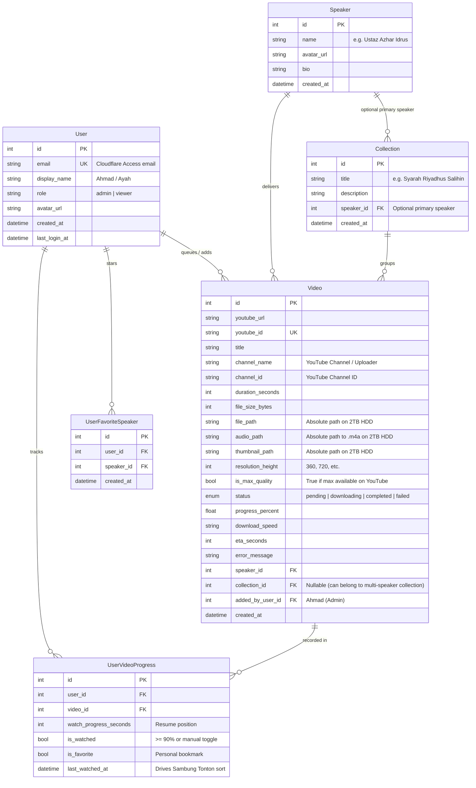
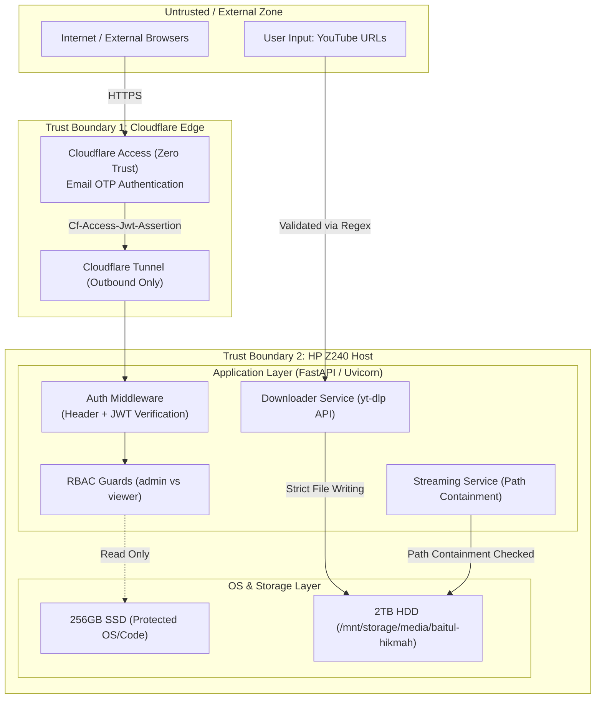

# Baitul Hikmah — Architecture & Requirements Specification
**Document Version:** 1.3  
**Status:** Requirements Refined & Finalized  
**Target Implementer:** Claude Code  

---

## 1. System Overview & Hardware Constraints

- **Host Machine:** HP Z240 Workstation (Ubuntu Server)
- **Primary OS Drive:** 256GB SSD (`/home/ahmadsalehuddin/code/personal/baitul-hikmah`)
  - **Rule:** Strictly for codebase, dependencies (`node_modules`, `venv`), and config. **NO media files or large DBs on SSD.**
- **Media & Storage Drive:** 2TB HDD mounted at `/mnt/storage`
  - Dedicated Baitul Hikmah directory: `/mnt/storage/media/baitul-hikmah`
  - Subdirectories:
    - `/mnt/storage/media/baitul-hikmah/videos/*.mp4`
    - `/mnt/storage/media/baitul-hikmah/thumbnails/*.webp`
    - `/mnt/storage/media/baitul-hikmah/baitul_hikmah.db`
  - Legacy directory (Read-only for migration): `/mnt/storage/media/ceramah`

---

## 2. Seed Users & Role-Based Access Control (RBAC)

### 2.1 Pre-seeded Accounts
| Email | Display Name | Role | Primary Use Case |
| :--- | :--- | :--- | :--- |
| `admin@example.com` | Ahmad | `admin` | Administer portal, download YouTube URLs, edit metadata, manage penceramah & collections, monitor server disk health. |
| `viewer@example.com` | Ayah | `viewer` | Senior-friendly viewing experience, personalized watch progress ("Sambung Tonton"), browse penceramah, toggle favorites. |

### 2.2 Permissions Matrix
| Action / Endpoint | Admin (Ahmad) | Viewer (Ayah) | Notes |
| :--- | :---: | :---: | :--- |
| **Browse Pustaka Ceramah** | Yes | Yes | Grid style view |
| **Play Video in Popup Modal (Video.js)** | Yes | Yes | Auto-start, resume progress |
| **Per-User Watch Progress ("Sambung Tonton")** | Yes (Personal) | Yes (Personal) | Unique per user account |
| **Favorite Video ("Kegemaran")** | Yes (Personal) | Yes (Personal) | Star/Heart toggle |
| **Favorite Penceramah** | Yes (Personal) | Yes (Personal) | 1-tap filter at top of library |
| **Tambah Ceramah (Download URL)** | **Yes** | **NO** | Restricted to Admin |
| **Sunting Butiran (Edit Video Info)** | **Yes** | **NO** | Restricted to Admin |
| **Urus Pustaka (Delete / Prune Videos)** | **Yes** | **NO** | Restricted to Admin |
| **View 2TB Server Storage Usage** | **Yes** | **NO** | Restricted to Admin |

---

## 3. Data Architecture (SQLModel / SQLite)



### 3.1 Key Schema Design Decisions
1. **Collections & Speakers Flexibility:** `Collection.speaker_id` is made **strictly optional (`Optional[int] = None`)**.
   - Single-speaker kitāb study (e.g. *Kitab Hikam* by Ustaz Nidzam) can link its primary speaker.
   - Multi-speaker thematic collections (e.g. *Daurah Ramadhan*, *Wacana Fiqh*, *Himpunan Kuliah Jumaat*) have `speaker_id = None`, with each individual `Video` referencing its respective `Speaker`.
2. **Decoupled Progress (`UserVideoProgress`):**
   - Playback progress, `is_watched`, and `is_favorite` are completely isolated per user account.
   - Composite Unique Index: `(user_id, video_id)`.
3. **Penceramah Favorites (`UserFavoriteSpeaker`):**
   - Allows Ayah to have a dedicated quick-access filter row of his favorite teachers at the top of the Pustaka without needing to search or type.

---

## 4. Video Player & UI Interaction Specification

### 4.1 Video Player Component (Video.js)
- **Engine:** `video.js` (React wrapper component).
- **Protocol:** HTTP 206 Partial Content (Byte-Range requests via `/api/stream/{video_id}`) for instant scrubbing on iOS, iPad, Safari, and desktop.
- **Features:**
  - Auto-start when modal opens (`autoplay: true`).
  - Resumes automatically from `watch_progress_seconds`.
  - Heartbeat: Throttled event sending progress updates every 5 seconds to `POST /api/progress/{video_id}`.
  - On `ended`: Sends `is_watched = true`.
  - Senior-friendly playback UI: Big pause/play button, 10s skip backward/forward buttons, large volume slider.

### 4.2 Pustaka Ceramah Popup Modal (Shadcn Dialog)
- In `PustakaPage.jsx`, clicking any video card / thumbnail triggers a Shadcn `Dialog`.
- **Modal Content Layout:**
  1. **Top Section:** 16:9 Video.js player container (auto-playing) with Mode Switcher (`[ 📹 Video ] [ 🎧 Audio ]`).
  2. **Metadata Header:**
     - Video Title in `font-heading` (`'Reem Kufi'`).
     - Speaker badge with avatar (links to speaker filter).
     - YouTube Channel badge (e.g. *Al-Khaadem*, *Madrasah Al Ikhlas*).
     - Duration badge and date added.
  3. **Action Bar:**
     - Mode Toggle: Video / Audio-Only.
     - "Tandai Telah Ditonton" (Toggle button).
     - "Kegemaran" (Star/Heart icon button).
  4. **Description Body:** Full lecture description and chapter notes (scrollable container with warm neutral styling).
  5. **Dismissal:** Closing the modal pauses playback and records final playback position.

### 4.3 Hybrid YouTube / Spotify Mode (Audio-Only Player)
*Designed specifically for senior convenience: listening in the car, on low data connections, or before sleeping with the phone screen turned off.*

1. **Backend Audio Extraction (1-Second Stream Copy):**
   - When a video is downloaded or migrated, extract the pure audio stream without transcoding:
     `ffmpeg -i input.mp4 -vn -c:a copy output.m4a`
   - Stored in `/mnt/storage/media/baitul-hikmah/audio/{video_id}.m4a`.
   - Adds only ~30MB–45MB per hour (tiny storage footprint on the 2TB drive).
2. **Frontend Spotify-Style Interface:**
   - When toggled to **Audio Mode**:
     - Video container shifts into an elegant "Now Playing" audio view with a warm Arabesque background pattern.
     - Center: High-resolution speaker portrait / kitāb artwork with subtle drop shadow.
     - Center/Bottom: Large, touch-friendly audio controls (10s back, extra-large Play/Pause, 10s forward, speed selector: 1x, 1.25x, 1.5x).
     - Seamless position sync: Switching between Video and Audio preserves the exact same playback timestamp (`currentTime`).
3. **Lock Screen & Background Audio (MediaSession API):**
   - Utilizes `navigator.mediaSession` metadata (`title`, `artist`: Speaker name, `album`: Collection name, `artwork`: Speaker avatar).
   - Allows Ayah to lock his phone/tablet and control playback directly from the lock screen or car Bluetooth controls without keeping the screen awake.

---

## 5. Legacy Migration from `ceramah-downloader`

### 5.1 Legacy Inspection Findings
- Legacy Project: `/home/ahmadsalehuddin/code/personal/ceramah-downloader`
- Legacy DB: `ceramah.db` containing **223 videos** in table `videos`:
  - `video_id` (YouTube 11-char ID)
  - `url` (Full YouTube link)
  - `title` (Structured title, e.g. `Risalah Cahaya Pengenalan | Ustaz Mohd Nidzam Bin Haji Omar | Madrasah Al Ikhlas | Siri 21`)
  - `duration` (integer seconds)
  - `file_path` (Filename in `/mnt/storage/media/ceramah/`)
- Existing video formats: `.mkv`, `.webm`, `.mp4`.

### 5.2 Migration Plan (`backend/scripts/migrate_legacy.py`)
1. **Safety First:** Read-only access to `/mnt/storage/media/ceramah` and `ceramah.db`.
2. **Metadata Extraction Heuristic:**
   - Parse pipe-delimited titles (`|` or `｜`):
     - Segment 1: Kitab / Collection Title (`Risalah Cahaya Pengenalan`)
     - Segment 2: Speaker Name (`Ustaz Mohd Nidzam Bin Haji Omar`)
     - Segment 3: Channel / Location (`Madrasah Al Ikhlas`)
     - Segment 4: Episode / Part (`Siri 21`)
   - Auto-create or link `Speaker` and `Collection`.
3. **Container Compatibility (FFmpeg Fast Remux):**
   - For `.mkv` and `.webm` files, execute `ffmpeg -i input.mkv -c copy output.mp4` to convert containers to `.mp4` without re-encoding (instant, zero quality loss, 100% compatible with iOS Safari byte-range streaming).
4. **Thumbnail Generation:** Extract frame at 00:01:00 as `.webp` thumbnail if missing.
5. **Database Linking:**
   - Insert into `Video` with status `completed`.
   - Set `added_by_user_id` to Ahmad's ID.
   - Set destination file path to `/mnt/storage/media/baitul-hikmah/videos/<filename>.mp4`.

---

## 6. Authentication: Cloudflare Zero Trust & Local Dev Strategy

### 6.1 Production Flow
- Cloudflare Access handles authentication in front of the home server tunnel.
- Cloudflare injects the HTTP request header:
  `Cf-Access-Authenticated-User-Email: viewer@example.com`
- Backend middleware matches email to database:
  - If `viewer@example.com` -> Authenticated as **Ayah (Viewer)**.
  - If `admin@example.com` -> Authenticated as **Ahmad (Admin)**.

### 6.2 Local Development Flow
- FastAPI middleware supports `X-Dev-User-Email` header fallback.
- In dev mode, a discrete user avatar switcher in the frontend navigation bar lets you toggle between Ahmad and Ayah to immediately test both views.

---

## 7. Security Architecture & Threat Model

### 7.1 Threat Model & Trust Boundaries



### 7.2 Entry Points & Untrusted Inputs
| Entry Point | Type | Trusted? | Threat Vectors | Mandatory Security Guard |
| :--- | :--- | :--- | :--- | :--- |
| `POST /api/videos/batch` | HTTP JSON | No | SSRF, Command Injection, Malicious URLs | 1. Strictly admin-only (`require_admin`).<br/>2. Strict regex whitelist for `youtube.com` and `youtu.be` links.<br/>3. Execute via Python `yt_dlp.YoutubeDL` API (never shell/subprocess). |
| `GET /api/stream/{video_id}` | HTTP GET | Semi | Path Traversal (`../../etc/shadow`) | 1. Video ID mapped from DB.<br/>2. `path.resolve().is_relative_to(STORAGE_DIR)` check before opening file. |
| `POST /api/progress/{video_id}` | HTTP POST | Semi | IDOR (Modifying another user's progress) | 1. Disregard user ID from body; strictly use `request.state.user.id` from verified session. |
| `Cf-Access-*` Headers | HTTP Header | Untrusted if direct | Header Spoofing / Privilege Escalation | 1. Bind Uvicorn strictly to `127.0.0.1` (never open public router ports).<br/>2. Verify `Cf-Access-Jwt-Assertion` cryptographic signature in production.<br/>3. Disable `X-Dev-User-Email` bypass when `ENVIRONMENT=production`. |

### 7.3 Specific Security Hardening Rules for Claude Code

#### 1. Zero Shell Execution for `yt-dlp`
* **Rule:** Never use `os.system()` or `subprocess.run(f"yt-dlp {url}", shell=True)`.
* **Implementation:** Always instantiate `with yt_dlp.YoutubeDL(ydl_opts) as ydl: ydl.download([validated_url])`.

#### 2. Strict YouTube URL Whitelist & SSRF Guard
* **Regex Pattern:** `r"^(https?://)?(www\.|m\.)?(youtube\.com/(watch\?v=|shorts/|playlist\?list=)|youtu\.be/)[a-zA-Z0-9_\-]{11}"`
* Any URL failing this pattern or resolving to `localhost`, internal subnets (`192.168.*`, `10.*`, `127.*`, `169.254.*`), or metadata services must be rejected immediately with HTTP 400.

#### 3. Path Traversal Containment (Streaming & Thumbnails)
```python
def verify_safe_path(target_path: Path, allowed_root: Path) -> Path:
    resolved_target = target_path.resolve()
    resolved_root = allowed_root.resolve()
    if not resolved_target.is_relative_to(resolved_root):
        raise HTTPException(status_code=403, detail="Akses ditolak: Laluan fail tidak sah.")
    if not resolved_target.exists():
        raise HTTPException(status_code=404, detail="Fail tidak dijumpai.")
    return resolved_target
```

#### 4. Disk Exhaustion & DoS Prevention
* **Quality Cap:** `format: "bestvideo[height<=720]+bestaudio/best[height<=720]"` — Prevents downloading 20GB 4K videos that waste disk space and home network bandwidth.
* **Low Disk Safeguard:** Check `shutil.disk_usage(STORAGE_DIR)`. If free space on `/mnt/storage` is less than 20GB, reject new downloads with HTTP 507 Insufficient Storage.
* **Sequential Download Queue:** Enforce maximum of 1 active download job at a time using an async queue (`asyncio.Queue`) so server memory and CPU are not overwhelmed.

#### 5. Strict Backend RBAC
* Frontend button hiding is **never** considered security.
* All state-mutating endpoints (`POST`, `PUT`, `DELETE` on videos, collections, speakers) MUST enforce a FastAPI dependency `require_admin` checking `user.role == Role.admin`.


---

## 8. Frontend Design System (Obra shadcn/ui)

### 8.1 Standing Design Rules (Permanent — applies to ALL agents and ALL future frontend work)
*Set by the System Owner on 2026-09-28. These rules override any conflicting guidance elsewhere.*

1. **shadcn/ui components only.** Every UI element must be built from official shadcn/ui components (the same components mirrored in the **Obra shadcn/ui Figma kit** used for the mockups in `docs/design/figma-ui/`). Components are added via the shadcn CLI into `frontend/src/components/ui/`. Never hand-roll an equivalent (e.g. custom dropdowns, raw `<select>`, homemade modals).
2. **Do not edit generated component source.** Files in `components/ui/` stay as the shadcn CLI generates them. App-specific pieces (e.g. lecture card, speaker card) are built by *composing* these components in feature files.
3. **Visual styling comes from the theme only.** Colours, typography, radius and shadows are defined exclusively by the theme tokens (CSS variables in `frontend/src/index.css`). `className` overrides on components are limited to layout (spacing, sizing, grid/flex, positioning) — never colour, font, radius or shadow.
4. **No arbitrary values.** No `text-[11px]`, inline hex colours, custom shadows, or other one-off styling. Use semantic token utilities (`bg-primary`, `text-muted-foreground`, …), never raw palette values.
5. **Theme changes require the System Owner's explicit permission.** Adding, removing or changing any theme token (colour, font, radius, shadow, spacing scale) must be approved by the System Owner first, then recorded in §8.2 below.
6. **Missing component = ask first.** If a design need cannot be met by an existing shadcn/ui component, stop and ask the System Owner rather than inventing a custom component or style.

### 8.2 Locked Theme & Approved Changes Log
**Locked baseline** (from `CLAUDE.md` → Design System & Figma Tokens and `docs/design/figma-variables/`):
- Fonts: `Reem Kufi` (headings), `Lato` (body), `Geist Mono` (mono).
- Colours: background `#FAFAF9`, foreground `#022C22`, primary `#96742B`, secondary `#E6F4EA`, secondary-foreground `#14532D`, muted/border `#E5E5E5`, card `#FFFFFF`.
- Base radius: `8px` (`0.5rem`).

**Approved changes:**
| Date | Change | Approved by |
| :--- | :--- | :--- |
| 2026-09-28 | Add `--warning` / `--warning-foreground` tokens (for the invalid-link Alert on Tambah Ceramah) | System Owner |

---

### 8.3 Redesign Requirements (Phase 7)
*Drafted by Claude and reviewed with the System Owner on 2026-09-28. Gemini review optional (for future tracking). Mockups: `docs/design/figma-ui/`. All items below are bound by §8.1.*

#### 8.3.1 Platform & Foundation
- **Tailwind CSS v3 → v4** and the **current shadcn/ui CLI** (`components.json`, JSX — `tsx: false`). Required for Input Group, Button Group, Empty, Field and Spinner used in the mockups.
- Theme tokens from §8.2 ported into Tailwind v4 CSS variables unchanged (exact hex values preserved). Light mode only this phase; token structure must allow dark mode to be added later (`docs/design/figma-variables/shadcn-color-dark.json`).
- **React Router** replaces the tab state in `App.jsx`:

| Route | Page |
| :--- | :--- |
| `/` | Pustaka Ceramah (home) |
| `/penceramah/:id` | Speaker view (breadcrumb: Laman Utama › {Penceramah}) |
| `/koleksi/:id` | Collection view (breadcrumb: Laman Utama › {Penceramah} › {Koleksi Kitab}) |
| `/cari?q=` | Search results (breadcrumb: Laman Utama › Mencari "{q}") |
| `/tambah` | Tambah Ceramah (admin) |
| `/urus` | Urus Pustaka (admin) |
| `?tonton=<id>` | Opens the video player dialog on top of any page. Refresh/share reopens it; browser Back closes it. |

#### 8.3.2 Component Mapping (mockup → shadcn/ui)
| Mockup element | shadcn/ui component |
| :--- | :--- |
| Search bar (icon + ✕ clear), title field with `19/200` counter | Input Group |
| Tapis \| Susun joined buttons | Button Group + Dropdown Menu |
| Tapis options | Dropdown Menu Checkbox Items |
| Susun options | Dropdown Menu Label + Radio Group / Radio Items |
| Laman Utama › … | Breadcrumb |
| "Hasil Carian Tidak Dijumpai", "Tiada Ceramah Untuk Ditambah" | Empty |
| "Memuatkan ceramah" | Spinner |
| Profile (CN) menu | Avatar + Dropdown Menu |
| Top navigation incl. "Urus Pustaka ⌄" | Navigation Menu (desktop), Sheet (phone) |
| Upload cards | Card + Progress + Button (`secondary`) |
| Invalid-link warning | Alert (uses approved `--warning` token) |
| Sunting Butiran Ceramah | Dialog + Field + Input Group |
| Koleksi Kitab / Penceramah pickers with "+ Tambah '…'" | Combobox (Popover + Command) |
| Duration on thumbnail | Badge |
| Watch progress on thumbnail | Progress |
| Delete confirmations | Alert Dialog |
| Admin tables | Table |

#### 8.3.3 Global Layout & Navigation
- Header: logo + "Baitul Hikmah" (`font-heading`), nav links **Pustaka Ceramah**, **Tambah Ceramah**, **Urus Pustaka ⌄**, avatar menu. Tambah/Urus hidden for `viewer` (backend `require_admin` remains the real guard).
- Profile menu: "Assalamualaikum, **{display_name}**" (spelling corrected from mockup), **Saiz Teks** control (§8.3.9), **Log Keluar**. Dev user switcher appears here **only in local development**.
- Page header pattern: H1 (`font-heading`) + one-line description + primary input, in a narrow centred column; content grid below in a wider column (as in mockups).

#### 8.3.4 Pustaka Ceramah (`/`, `/penceramah/:id`, `/koleksi/:id`, `/cari`)
- **Mixed grid** of three card types, all composed from shadcn parts:
  - **Video card:** 16:9 thumbnail, duration Badge bottom-right, gold Progress bar along the bottom when partially watched; title (**clamped to 2 lines** with ellipsis; full title via Tooltip on desktop, and in the player dialog); Koleksi Kitab name; Penceramah • relative date ("2 hari lalu").
  - **Koleksi Kitab card:** stacked-thumbnail look; title; speaker name(s) ("Ustaz A, Ustaz B dan lain"). Opens `/koleksi/:id`.
  - **Penceramah card:** Avatar centred on muted thumbnail area; name; "{n} ceramah dan {m} koleksi kitab". Opens `/penceramah/:id`.
- **Tapis:** Video Ceramah / Koleksi Kitab / Penceramah — **all ticked by default**; at least one must remain ticked (last one cannot be unticked). No "Semua" row. When not all are ticked, the Tapis button shows a count Badge (e.g. "Tapis · 2"). A separate group adds a **Kegemaran Sahaja** checkbox (favourites only).
- **Susun:** a **single** selection across groups:
  - *Mengikut Tarikh Muat Naik:* Sekarang – Dulu (**default**), Dulu – Sekarang
  - *Mengikut Abjad:* A – Z, Z – A
  - *Mengikut Siri* (Siri 1 → N): shown **only inside `/koleksi/:id`**, where it is the default. Uses the new `Video.series_number` field (§8.3.11).
- **Search:** Input Group with clear (✕); navigates to `/cari?q=`. No results → Empty ("Hasil Carian Tidak Dijumpai", "Padam carian dan cuba semula kata kunci yang baharu atau kembali ke halaman utama.", link "Laman Utama").
- **Progressive loading:** client-side batches (e.g. 24 cards) revealed on scroll with Spinner + "Memuatkan ceramah". No backend paging this phase.
- **Sambung Tonton:** single horizontal row of in-progress video cards above the grid, shown on `/` only when not searching/filtered to a speaker or collection. (Live feature, redesigned; not in mockups.)

#### 8.3.5 Video Player Dialog (no mockup — designed from shadcn parts)
- Dialog (wide on desktop; **full-screen on phone**), opened via `?tonton=<id>`.
- Top: 16:9 player area. Mode switch **Video / Audio** (Toggle Group).
- Metadata: title (`font-heading`); Penceramah Badge (links to `/penceramah/:id`), channel Badge, duration Badge, date added.
- Actions: **Tandai Telah Ditonton** and **Kegemaran** (Toggle / Button with pressed state).
- Description in Scroll Area.
- **Audio mode** (per §4.3): Card with Arabesque pattern asset, large speaker Avatar / kitab artwork, Slider for position, large icon Buttons (10s back, Play/Pause, 10s forward), speed Toggle Group (1x / 1.25x / 1.5x).
- Existing behaviour retained: resume position, 5s progress heartbeat, save on close, MediaSession, seamless Video↔Audio sync.
- **Controls (O4 resolved):** Video.js is the playback engine only (`controls: false`). One shared control set built from shadcn parts is used in **both** Video and Audio mode: seek Slider, current/total time, 10s back, Play/Pause, 10s forward, speed Toggle Group, volume Slider + mute, **fullscreen** (Video mode), plus: controls auto-hide when idle and reappear on tap/mouse move, loading Spinner while buffering, error state (Empty/Alert), keyboard shortcuts (Space/K play-pause, ←/→ skip, F fullscreen, M mute) and ARIA labels. Controls scale with Saiz Teks. Note: iPhone native fullscreen always uses iOS system controls.

#### 8.3.6 Tambah Ceramah (`/tambah`)
- Input Group (link icon), placeholder "Masukkan sehingga 5 pautan YouTube pada satu masa…"; **max 5 links per batch**, single-line input (links separated by space/comma).
- Buttons: **Kosongkan Pautan** (outline) and **Muat Naik** (primary), right-aligned. Wording "Muat Naik" kept as in Figma.
- Invalid links → warning Alert: "{n} pautan tidak sah/ditemui", "Sila pastikan pautan berikut adalah dari YouTube dan sah/aktif:", list of links.
- Upload cards: thumbnail, title (truncated), *Koleksi Kitab* label/value, *Penceramah* label/value, duration + file size with icons, **Sunting Butiran** (secondary); footer Progress + % + status text ("Muat naik selesai.").
- Empty: "Tiada Ceramah Untuk Ditambah" / "Masukkan pautan di atas dan klik butang 'Muat Naik' untuk mula menambah ceramah."

#### 8.3.7 Sunting Butiran Ceramah (Dialog)
- Thumbnail preview with two overlay icon Buttons: **upload own image** and **reset to default thumbnail** (original YouTube thumbnail).
- Fields: **Tajuk Ceramah** (Input Group with character counter), **Siri** (number, optional — addition to mockup), **Nama Koleksi Kitab** and **Penceramah** (Combobox with inline "+ Tambah '{typed}'" to create new).
- Footer: **Batal** (outline), **Simpan** (primary).
- **Title length (O5 resolved):** max **200** characters in this form (counter `n/200`). Existing longer titles are kept until edited.

#### 8.3.8 Urus Pustaka (`/urus`) — redesign of the live management screen
The "Fungsi Baharu Sedang Dibangunkan" mockup is obsolete. Redesign keeps all live functionality:
- **Storage health** Card: 2TB usage Progress, free space, low-disk warning Alert.
- **Tabs:** *Ceramah* | *Koleksi Kitab* | *Penceramah* (also reachable from the "Urus Pustaka ⌄" nav menu).
  - *Ceramah:* Table with search (Input Group) and Penceramah filter (Select/Combobox); row actions via Dropdown Menu: Sunting (opens §8.3.7 dialog), Cuba Semula (failed items), Padam (Alert Dialog).
  - *Koleksi Kitab:* Table with video counts; Sunting, Gabung (merge), Padam.
  - *Penceramah:* Table with video counts; Sunting.
  - "Tambah Penceramah atau Koleksi" dialog: Dialog + Field + Radio Group (type).
- Phone: tables collapse to Card lists.
- Non-admin: Empty state "Akses Ditolak" + "Kembali ke Laman Utama".

#### 8.3.9 Accessibility — Saiz Teks
- Default = Obra kit sizing. Four steps: **Kecil (87.5%) · Biasa (100%, default) · Besar (112.5%) · Sangat Besar (125%)**, applied as root font-size so every rem-based shadcn size scales together.
- Control: − / + Button Group with current label, inside the profile menu.
- Persisted **per user in the database** (new `User` preference field + endpoint) so it follows the user across devices.

#### 8.3.10 Responsive Layout
| | Phone (<640px) | Tablet (640–1023px) | Desktop (≥1024px) |
| :--- | :--- | :--- | :--- |
| Navigation | Sheet (hamburger) | Navigation Menu | Navigation Menu |
| Pustaka grid | 1 col | 2 col | 3–4 col |
| Tambah upload cards | 1 col | 2–3 col | up to 5 col |
| Player dialog | Full-screen | Wide dialog | Wide dialog |
| Urus tables | Card list | Table (horizontal scroll if needed) | Table |

#### 8.3.11 Required Backend Additions
- `POST /api/videos/{id}/thumbnail` — upload custom image (admin; validate type/size, convert to WebP, path containment per §7.3).
- `DELETE /api/videos/{id}/thumbnail` (or reset action) — restore default YouTube thumbnail.
- `User` text-size preference field + `PUT /api/auth/me/preferences`.
- `Video.series_number` (optional int): auto-parsed from "Siri N" in titles on download and via a one-off backfill for existing videos; editable as an extra Field in Sunting Butiran Ceramah (§8.3.7).

#### 8.3.12 Open Items (to resolve before implementation)
- ~~O1 — Tapis "Semua"~~ **Resolved 2026-09-28:** no "Semua" row; count Badge on Tapis button (§8.3.4).
- ~~O2 — Sambung Tonton & Kegemaran~~ **Resolved 2026-09-28:** Sambung Tonton row on home; "Kegemaran Sahaja" in Tapis (§8.3.4). Principle: Figma is the starting point; where the live app differs, the live app is newer, and Claude's redesign (within §8.1) is preferred.
- ~~O3 — Series number~~ **Resolved 2026-09-28:** add `Video.series_number` (§8.3.11).
- ~~O4 — Video.js controls~~ **Resolved 2026-09-28:** custom controls from shadcn parts; Video.js engine only (§8.3.5).
- ~~O5 — Title length~~ **Resolved 2026-09-28:** 2-line clamp on cards + 200-char limit in Sunting form (§8.3.4, §8.3.7).

**All open items resolved. Requirements finalized pending System Owner's go-ahead to start coding.**
